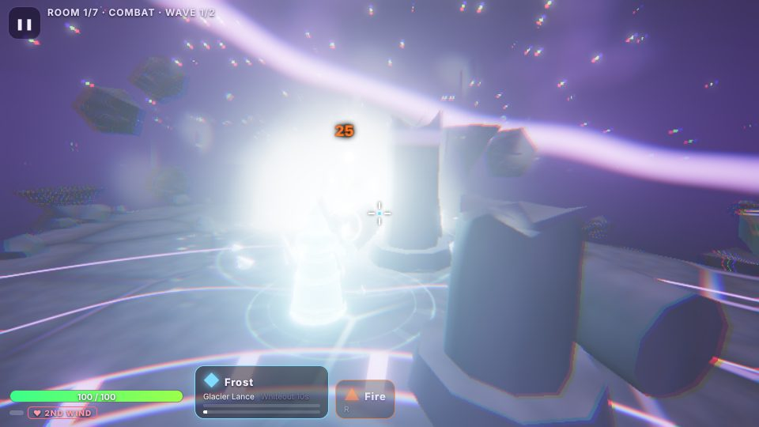
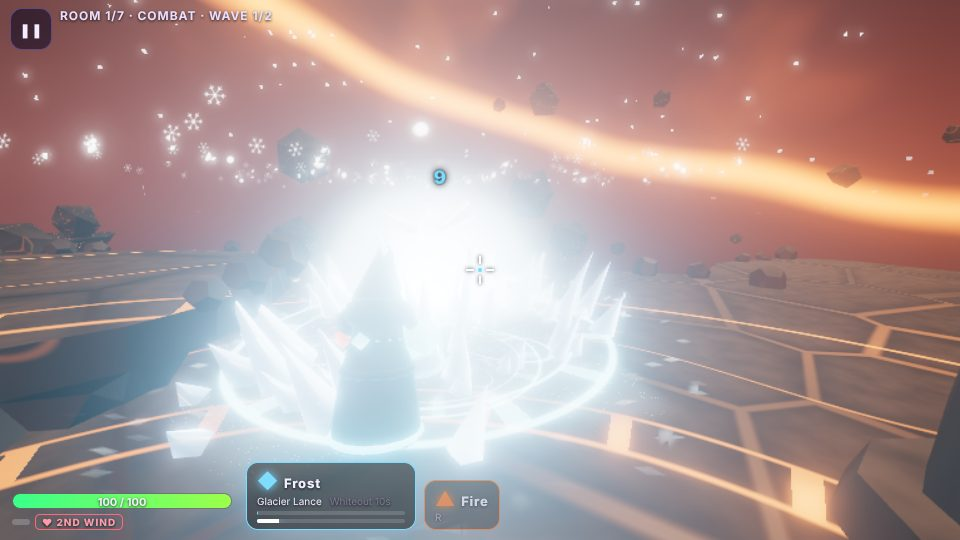
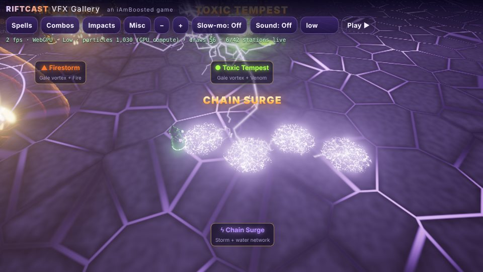
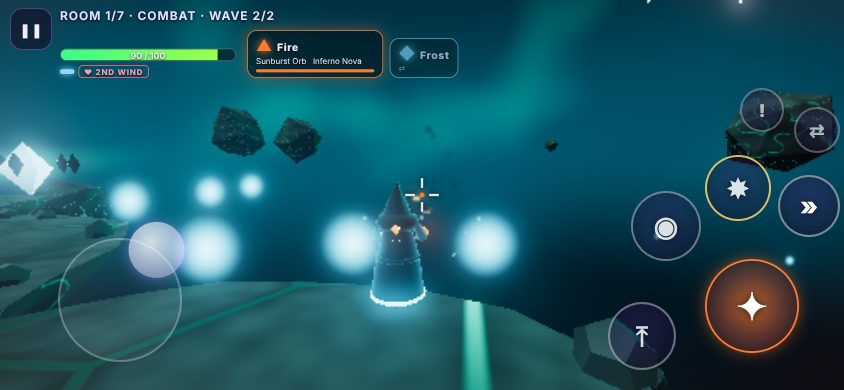

# Riftcast

**Live:** https://iamboosted.github.io/riftcast/ · **VFX gallery:** https://iamboosted.github.io/riftcast/vfx-gallery/

*An iAmBoosted game* — [github.com/iamboosted](https://github.com/iamboosted)

A zero-asset 3D co-op elemental mage roguelite for 1–4 players, running in the browser on Three.js `WebGPURenderer` + TSL (with automatic WebGL2 fallback). Every mesh, texture, particle sprite, shader and sound is generated at runtime. It loads instantly, needs no login, and plays on desktop (mouse/keyboard or gamepad) and on iPhone in landscape (twin-stick touch).

## Play

- **Solo:** press *Play Solo*.
- **Co-op:** one player presses *Host Co-op* and shares the 5-letter room code or link. Friends press *Join with Code* (or open the link). Peer-to-peer WebRTC; no server of ours.
- **iPhone:** open in Safari, rotate to landscape, and use *Share → Add to Home Screen* for fullscreen.

### Controls

| Action | Keyboard / mouse | Gamepad | Touch |
|---|---|---|---|
| Move | WASD | Left stick | Left-side floating stick |
| Aim | Mouse | Right stick | Right-side stick (drag), or drag the cast buttons |
| Primary (hold to auto-fire) | LMB | RT | ✦ |
| Heavy (hold to charge) | RMB | LT | ◉ |
| Signature | Q / E | RB / X | ✸ |
| Dash | Shift | B | » |
| Jump / double jump / hold to hover | Space | A | ⤒ |
| Swap gauntlet | R / wheel | LB / Y | ⇄ |
| Ping | G / MMB | D-pad up | ! |

## Elements and combos

Six gauntlets: **Fire, Frost, Storm, Gale, Stone, Venom.** Each has a primary, a charged heavy and a signature ability. You equip two and can swap between them mid-fight.

Elements react through world state regardless of who cast them, and every contributor gets credit:

- Gale vortex + Fire → **Firestorm** · + Venom → **Toxic Tempest** · + Frost → **Blizzard** · + Storm → **Thunderhead**
- Fire + Venom cloud → **Detonation** (chains through nearby clouds)
- Storm + water/frost surface → **Chain Surge** across the whole connected puddle network
- Stone + frozen enemy → **Shatter** · Fire + frost → **Steam Burst** (blinds) · Frost + puddle → **Flash Freeze**
- Stone walls block projectiles and redirect Gale; Fire turns them into **Magma Walls**

The table lives in [`src/data/combos.json`](src/data/combos.json), so adding a combo is a data change.

## Screenshots

Captured automatically by `scripts/screenshots.mjs` (Playwright, WebGPU via SwiftShader):

| Combat (High) | Combat (Ultra) |
|---|---|
|  |  |
| **VFX gallery: Chain Surge (Low)** | **iPhone landscape, touch controls** |
|  |  |

## Develop

```bash
npm ci
npm run dev        # http://localhost:5173/riftcast/
npm test           # vitest: unit + multiplayer integration tests
npm run build      # typecheck + production build to dist/
```

URL flags: `?webgl` forces the WebGL2 backend · `?quality=low|medium|high|ultra` · `?autoplay` jumps straight into a solo run.

See [DECISIONS.md](DECISIONS.md) for design calls and [STATUS.md](STATUS.md) for current state.

---

Copyright (c) 2026 iAmBoosted. All rights reserved. This code is public for viewing only; no permission is granted to copy, modify, distribute, or use it. See [LICENSE](LICENSE).
